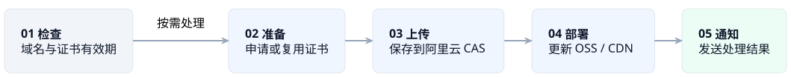

# 阿里云 OSS 证书自动化工具

[](https://github.com/nekoimi/oss-auto-cert/releases)
[](LICENSE)

自动申请和续期 Let's Encrypt SSL 证书，并更新阿里云 OSS 与已开启 HTTPS 的 CDN 域名证书。

- **自动续期**：定期检查证书，在到期前完成申请和部署。
- **多域名管理**：支持多个 Bucket，可指定需要管理的域名。
- **失败恢复**：保存证书和部署进度，分别恢复 OSS / CDN 的失败任务。
- **消息通知**：支持企业微信、钉钉、飞书和自定义 Webhook。

## 快速开始

安装 Docker 和 Docker Compose，在同一目录准备以下三个文件。

### 1. 配置域名

创建 `config.toml`，填写邮箱、已有 Bucket 和已绑定的域名。下面包含常用的巡检、续期和部署设置；所有参数及多 Bucket、通知示例见 [完整配置](examples/config.full.toml)。

```toml
[storage]
data-dir = "/var/lib/oss-auto-cert" # 证书与账户的持久化目录

[schedule]
interval = "6h"                  # 巡检间隔
run-on-start = true              # 启动后立即巡检

[renewal]
before-days = 15                 # 提前续期天数，范围 1～60

[acme]
email = "admin@example.com"
environment = "production"      # 正式证书

[[buckets]]
name = "my-bucket"
endpoint = "oss-cn-hangzhou.aliyuncs.com"
domain-mode = "listed"           # 只管理下面列出的已绑定域名
domains = ["static.example.com"]
allow-initial-issuance = false   # 域名尚未绑定证书时改为 true

[buckets.deploy]
oss = true
cdn = "auto"                    # 仅用 OSS 时改为 "off"，避免查询 CDN

# 可选企业微信通知：已内置模板，仅需配置机器人地址
# [[notifications]]
# type = "wecom"
# url-env = "CERT_WEBHOOK_URL"
# events = ["updated", "failed", "recovered"]
```

域名的 `http://域名/.well-known/acme-challenge/令牌` 必须能够通过公网访问，并指向对应 Bucket，以完成证书申请时的域名验证。所用阿里云账号需要具备 OSS、CAS 及相关 CDN 操作权限，详见 [部署与权限说明](docs/usage.md#8-docker权限与-systemd)。

企业微信、钉钉和飞书均内置通知模板，无需自行编写消息内容。启用时取消对应配置注释，并在 Compose 服务中传入 `url-env` 对应的环境变量，步骤见 [通知设置](docs/usage.md#5-通知)。

### 2. 填写镜像和凭证

创建 `.env`：

```dotenv
OSS_AUTO_CERT_IMAGE=nekoimi/oss-auto-cert:<版本号>
OSS_ACCESS_KEY_ID=你的阿里云AccessKeyId
OSS_ACCESS_KEY_SECRET=你的阿里云AccessKeySecret
```

将 `<版本号>` 替换为与上述 TOML 配置对应的发行版镜像标签，标签不带开头的 `v`。版本说明见 [Releases](https://github.com/nekoimi/oss-auto-cert/releases)。镜像可从以下地址获取，选择其中一个填写到 `OSS_AUTO_CERT_IMAGE`：

| 镜像仓库 | 镜像地址 |
| --- | --- |
| Docker Hub | `nekoimi/oss-auto-cert:<版本号>` |
| GitHub Container Registry | `ghcr.io/nekoimi/oss-auto-cert:<版本号>` |
| 阿里云镜像仓库 | `registry.cn-hangzhou.aliyuncs.com/nekoimi/oss-auto-cert:<版本号>` |

### 3. 启动服务

创建 `compose.yaml`：

```yaml
services:
  oss-auto-cert:
    image: ${OSS_AUTO_CERT_IMAGE:?请在 .env 中填写镜像地址}
    restart: unless-stopped
    command: [run, --config=/etc/oss-auto-cert/config.toml, --color=never]
    environment:
      OSS_ACCESS_KEY_ID: ${OSS_ACCESS_KEY_ID:?请填写阿里云 AccessKeyId}
      OSS_ACCESS_KEY_SECRET: ${OSS_ACCESS_KEY_SECRET:?请填写阿里云 AccessKeySecret}
      ACME_DATA_DIR: /var/lib/oss-auto-cert
    volumes:
      - ./config.toml:/etc/oss-auto-cert/config.toml:ro
      - cert-data:/var/lib/oss-auto-cert

volumes:
  cert-data:
```

拉取镜像、校验配置并启动：

```bash
docker compose pull
docker compose run --rm oss-auto-cert config validate --config=/etc/oss-auto-cert/config.toml
docker compose up -d
docker compose logs -f oss-auto-cert
```

服务默认启动时检查一次，之后每 6 小时巡检。证书、账户和部署进度保存在 Docker 数据卷中，重建容器后继续保留。

需要非 root 运行、资源限制或自定义数据目录时，可使用 [生产部署配置](docker-compose.yaml)，具体步骤见 [部署说明](docs/usage.md#8-docker权限与-systemd)。

## 工作流程



证书正常时跳过更新；需要续期时申请新证书，部署未完成时优先复用已保存的有效证书。OSS 与 CDN 分别核验和保存进度，一个目标失败不会阻止另一个目标更新。

## 常用操作

只读查看处理计划，不申请证书、不更新云资源：

```bash
docker compose run --rm oss-auto-cert run --dry-run --config=/etc/oss-auto-cert/config.toml
```

查看最近一次保存在本地的运行状态：

```bash
docker compose exec oss-auto-cert status --config=/etc/oss-auto-cert/config.toml
```

暂停服务，保留证书数据：

```bash
docker compose stop
```

旧 YAML 配置可以继续使用，也可迁移为 TOML，操作步骤见 [升级与回退说明](docs/usage.md#7-旧版升级与回退)。

## 更多文档

- [完整配置示例](examples/config.full.toml)
- [使用、部署与故障恢复](docs/usage.md)
- [日志设置](docs/logging.md)
- [变更记录](CHANGELOG.md)

## 许可证

[MIT License](LICENSE)
